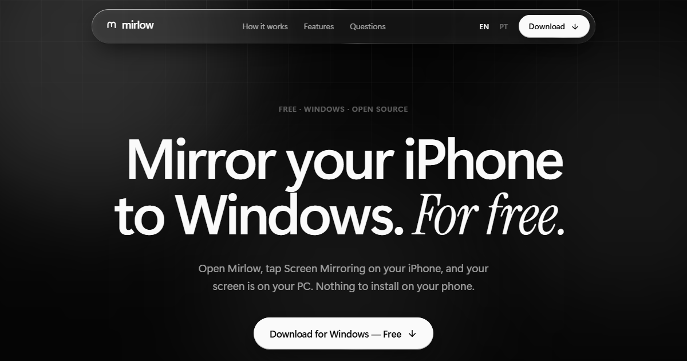

<div align="center">


# Mirlow

**Mirror your iPhone to Windows. For free.**

Open Mirlow, tap Screen Mirroring on your iPhone, and your screen is on your PC.<br>
No app on the phone, no account, no cable.

[](https://github.com/franciscogfsm/Mirlow/releases)
[](https://github.com/franciscogfsm/Mirlow/releases/latest)
[](https://github.com/franciscogfsm/Mirlow/stargazers)
[](LICENSE)
[](#install)

### [Download for Windows](https://github.com/franciscogfsm/Mirlow/releases/latest/download/Mirlow-Setup-x64.exe)

<sub>Windows 10 and 11, 64-bit · No account · No signup</sub>

<br>



</div>

## How it works

| 1. Open Mirlow | 2. Tap Screen Mirroring | 3. See it on your PC |
| --- | --- | --- |
| Your PC becomes discoverable the moment the app opens. There is nothing to set up. | Swipe down to Control Centre on your iPhone or iPad and choose your PC from the list. | Your screen appears with its sound, and follows along as you rotate your phone. |

## What you get

- **Wireless mirroring.** Uses the Screen Mirroring built into your iPhone, iPad and Mac. No app, no cable.
- **Sound included.** Hear your phone's audio through your PC speakers, in step with the picture.
- **Full screen.** One key takes your phone edge to edge. Portrait and landscape both fit.
- **Private by design.** Everything stays on your own network. No servers, no account, no tracking.
- **Free, for real.** No trial, no watermark, no subscription. The code is here for anyone to read.

## Install

1. [Download the installer](https://github.com/franciscogfsm/Mirlow/releases/latest/download/Mirlow-Setup-x64.exe) and run it.
2. Open Mirlow.
3. On your iPhone, open Control Centre, tap **Screen Mirroring** and choose your PC.

Both devices need to be on the same Wi-Fi or wired network.

The installer is not code-signed yet, so Windows may say "Windows protected
your PC" the first time. Choose **More info**, then **Run anyway**. You do not
have to take that on trust: every release lists the installer's SHA-256 in
`SHA256SUMS.txt`, and you can compare it with your download by running
`Get-FileHash .\Mirlow-Setup-x64.exe` in PowerShell.

## Questions

<details>
<summary><b>Do I need to install anything on my iPhone?</b></summary>

No. Mirlow works with the Screen Mirroring button that is already in Control Centre.
</details>

<details>
<summary><b>My PC doesn't appear on my iPhone. What now?</b></summary>

Check that both devices are on the same network, then use the "Can't see this
PC?" link inside Mirlow. It can allow the app through the Windows firewall for
you, which is the usual cause.
</details>

<details>
<summary><b>Can it play films from streaming apps?</b></summary>

Mirlow mirrors your screen. Apps that protect their video, such as most film
and TV services, show a black picture when mirrored. That is decided by those
apps, not by Mirlow.
</details>

<details>
<summary><b>Does my screen go through the internet?</b></summary>

No. Your iPhone sends its screen straight to your PC over your local network.
Mirlow has no servers and collects nothing.
</details>

<details>
<summary><b>Is Mirlow made by Apple?</b></summary>

No. Mirlow is an independent open-source project built on
[UxPlay](https://github.com/FDH2/UxPlay). It is not affiliated with, endorsed
by, or certified by Apple Inc.
</details>

## Support the project

If Mirlow is useful to you, [star the repository](https://github.com/franciscogfsm/Mirlow/stargazers)
so other people can find it, and [open an issue](https://github.com/franciscogfsm/Mirlow/issues)
when something does not work.

---

## How it is built

| Part | Where | What it is |
| --- | --- | --- |
| Desktop app | [`apps/desktop`](apps/desktop) | Tauri 2 (Rust) and React. The window, the notification-area icon, settings and diagnostics. |
| Engine integration | [`apps/desktop/src-tauri/src`](apps/desktop/src-tauri/src) | Runs and supervises the AirPlay engine, and places its video window inside the app. |
| AirPlay engine | [`engine`](engine) | [UxPlay](https://github.com/FDH2/UxPlay) at a pinned commit, plus two small [patches](engine/patches). Mirlow does not reimplement the protocol. |
| Website | [`apps/web`](apps/web) | Next.js, exported as static files. English and European Portuguese. |
| Design system | [`packages/ui`](packages/ui) | Colour tokens, the logo, and the glass material used by both the app and the site. |
| Translations | [`packages/i18n`](packages/i18n) | One set of strings for the app and the site. |
| Build scripts | [`scripts`](scripts) | Build the engine, assemble its runtime, build the installer. |

Three decisions shape the rest:

- **Nothing to install besides Mirlow.** The installer carries the engine and
  every library it needs (GStreamer, FFmpeg and their dependencies). UxPlay is
  built with its internal mDNS responder, so Apple's Bonjour is not required.
- **The picture is drawn natively.** Video is decoded and rendered with
  Direct3D 11 by GStreamer, in a window that belongs to the engine. Mirlow
  adopts that window as a child of its own and lays it out; the web view never
  touches video frames. See [`video.rs`](apps/desktop/src-tauri/src/video.rs).
- **The engine tells Mirlow what is happening.** A patch makes UxPlay print one
  machine-readable line per state change, so the interface reflects real
  connections, real picture sizes and real disconnections. Nothing in the app
  is simulated.

## What has and has not been verified

Verified on Windows 11 (the machine this was built on):

- The engine builds, and runs from its bundled runtime with no MSYS2,
  GStreamer or Bonjour on the PATH.
- It advertises `_airplay._tcp` and `_raop._tcp` over mDNS on the Wi-Fi
  interface (observed with an independent mDNS listener).
- Mirlow starts it, tracks its state, restarts it after a crash, stops it
  cleanly on exit, and the engine never outlives the app.
- A real Direct3D 11 video window from another process is adopted, sized to
  the picture's proportions, follows portrait/landscape changes, and is
  released on disconnect (exercised with the development stand-in engine).
- The website builds, in both languages, with language detection and hreflang.
- The installer builds.

**Not verified here, because it needs an Apple device:** discovery from a real
iPhone, an actual mirroring session, sound, and input passing through the
picture to the window. Run [`docs/VALIDATION.md`](docs/VALIDATION.md) before
relying on it or publishing a release.

## Build it yourself

```powershell
git clone --recurse-submodules https://github.com/franciscogfsm/mirlow
cd mirlow
npm install
.\scripts\build-engine.ps1 -InstallDeps   # once: builds the AirPlay engine
npm run dev:desktop                       # the app
npm run dev:web                           # the website, at http://localhost:5184
```

Prerequisites and everything else are in
[`docs/DEVELOPMENT.md`](docs/DEVELOPMENT.md). Building the installer and
publishing a release are in [`docs/RELEASING.md`](docs/RELEASING.md).

## Licence

Mirlow is free software under the [GNU General Public License v3.0 or
later](LICENSE), the licence of the UxPlay engine it is built on. The software
shipped with it, and how to get all the source, are listed in
[`THIRD-PARTY-NOTICES.md`](THIRD-PARTY-NOTICES.md).

The licence covers the code. It does not cover the name "Mirlow" or the
Mirlow logo: a modified version has to be distributed under a different name
and its own branding, and must not suggest that it is the original.
